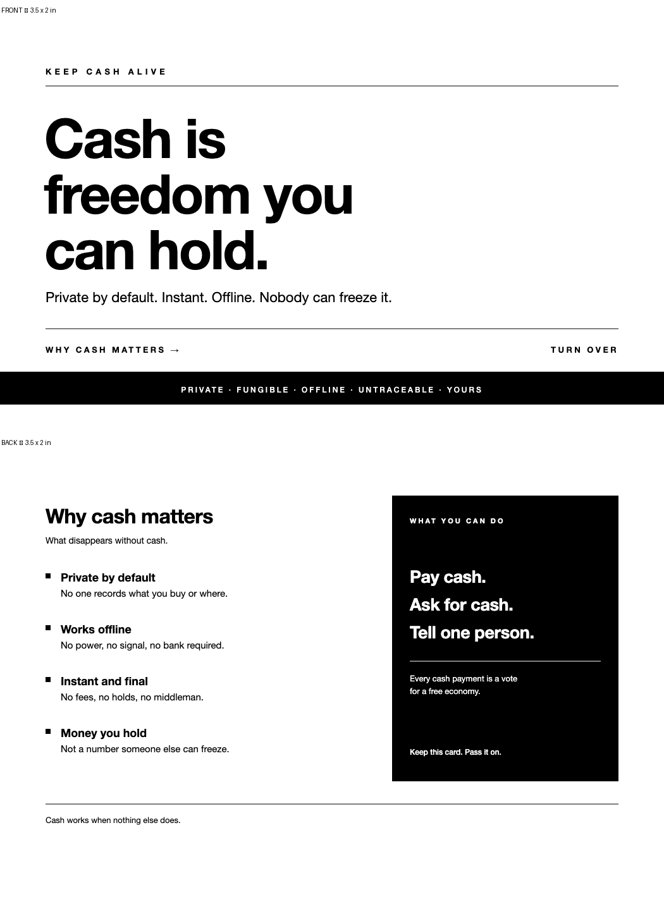

# Cash matters — a two-sided handout the size of a business card

Entry for poidh bounty **#1510** — *"Create business card sized handout on the benefits of
using/accepting cash."*



Pure black and white, 3.5 × 2 in (85.6 × 50.8 mm), print-ready, nothing to install.

## The copy

**Front**

> KEEP CASH ALIVE
>
> # Cash is
> # freedom you
> # can hold.
>
> Private by default. Instant. Offline. Nobody can freeze it.
>
> WHY CASH MATTERS → · TURN OVER
>
> `PRIVATE · FUNGIBLE · OFFLINE · UNTRACEABLE · YOURS`

**Back**

> # Why cash matters
> *What disappears without cash.*
>
> ▪ **Private by default** — No one records what you buy or where.
> ▪ **Works offline** — No power, no signal, no bank required.
> ▪ **Instant and final** — No fees, no holds, no middleman.
> ▪ **Money you hold** — Not a number someone else can freeze.
>
> **WHAT YOU CAN DO → Pay cash. Ask for cash. Tell one person.**
> Every cash payment is a vote for a free economy. *Keep this card. Pass it on.*
>
> Cash works when nothing else does.

The front is a statement you can read in one second at arm's length. The back gives four
concrete reasons and three instructions. No jargon, no lecture, no QR code that dies.

## Files

| file | what it is |
|---|---|
| `out/front.svg`, `out/back.svg` | vector source, 1050 × 600 px = 3.5 × 2 in @ 300 dpi, `#000`/`#fff` only |
| `out/front.png`, `out/back.png` | 300 dpi grayscale raster, 1050 × 600 px |
| `out/card-print.pdf` | 2 pages, **exact 3.5 × 2 in** trim (252 × 144 pt) |
| `out/card-print-bleed.pdf` | 2 pages, 3.75 × 2.25 in, 0.125 in bleed on every side |
| `out/card-preview.png` | both sides on one sheet, for this page |
| `build_1510.py` | regenerates every file above (`python3 build_1510.py`) |
| `verify_1510.py` | 53 mechanical checks — geometry, pure B/W, no external refs, ink coverage, PDF page boxes, word budgets |

## Print it

1. Send `out/card-print-bleed.pdf` to any print shop, or print it at home on 250–300 gsm
   card stock and cut on the trim line.
2. **Black only.** The file has no colour channel, so a mono printer produces exactly what you
   see; no registration shift, no colour cast.
3. Ask for matte or uncoated stock — a handout that feels like paper, not plastic, is more
   likely to be kept.
4. If you print at home, use the no-bleed PDF and cut 3 mm inside the edge.

## Why this design

* **One idea per side.** Front = the promise. Back = the proof. A card that tries to say six
  things says nothing.
* **Type does the work.** 86 px headline, 15 px body, 1 px hairlines. No clip-art coins, no
  shackled hands, no stock photography — those read as "conspiracy flyer" and get thrown away.
* **The CTA is three verbs**, in the order of increasing commitment: pay cash, ask for cash,
  tell one person.
* **Prints for pennies.** One colour, no gradients, no images: a 500-card run on a digital press
  is a few dollars.

## Verify

```
$ python3 verify_1510.py
53/53 checks passed
VERDICT: PASS — #1510 artifact meets every mechanical requirement of the brief.
```

The verifier fails on a colour value that is not `#000`/`#fff`, on any `<image>`/`href`/`url(#)`
reference, on a wrong page box, on a wrong DPI, on chroma in the PNG, on ink coverage outside
2–45 %, on missing privacy/offline/freedom claims, and on a missing imperative CTA.

## Licence

CC0 1.0 — copy it, print it, change the headline, hand it out. Cash is a public good; so is this.
